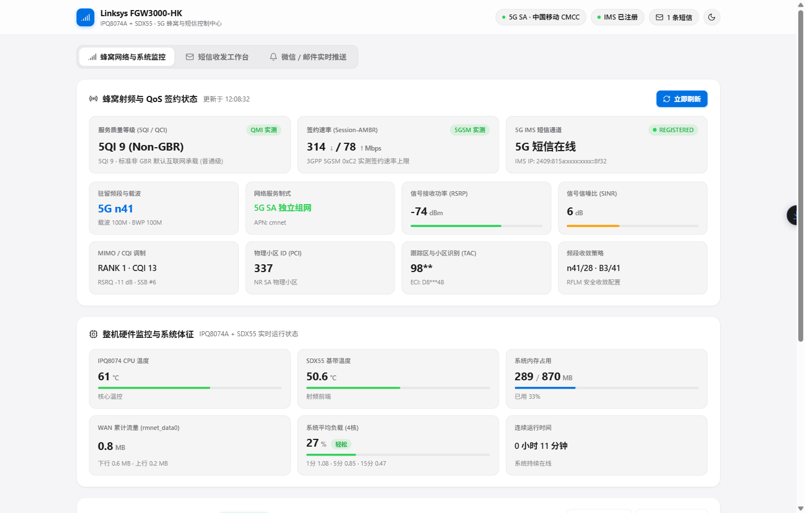
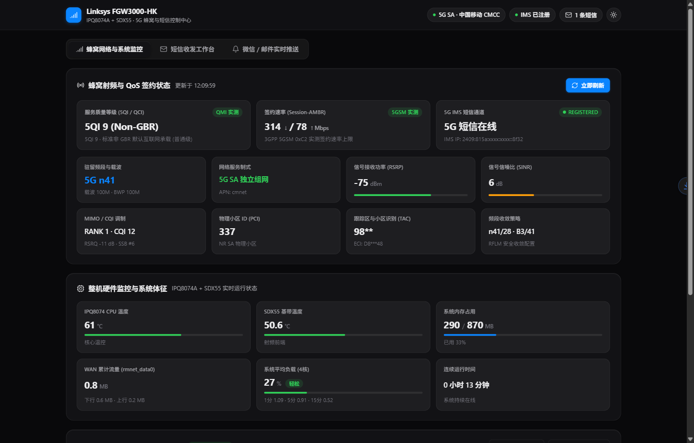
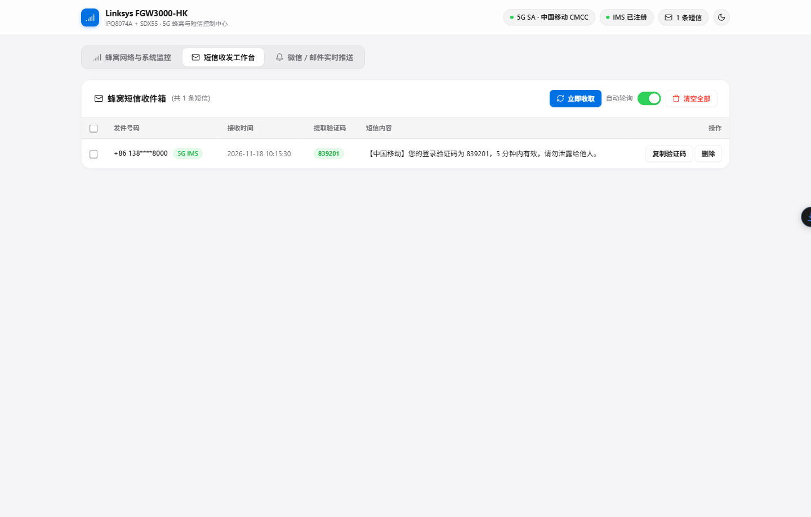
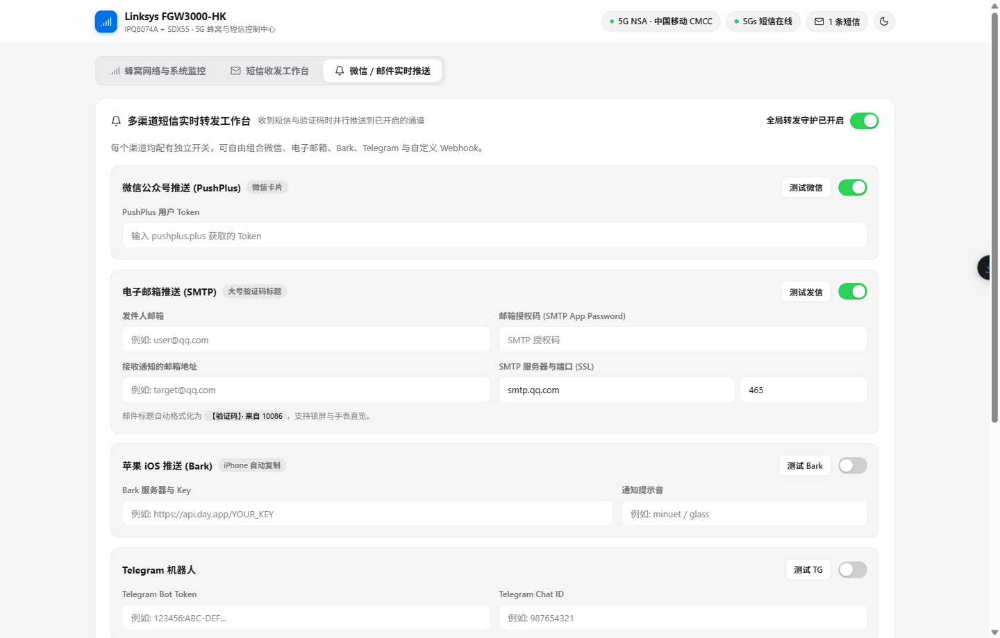

# Linksys FGW3000-HK Enhanced（仅适用于 FGW3000-HK）

> **⚠️ 本项目的 HTML/脚本/刷机包均为 Linksys FGW3000-HK 专用，其他型号（如 FGW3000 / 非 HK 版）不适用！**
>
> 为 **Linksys FGW3000-HK**（高通 IPQ8074A + 骁龙 SDX55 5G CPE，香港版）打造的
> **调试权限开启 + 5G SA 频段解锁 + 基带本地 5G IMS 短信 + 极客 Web 控制台** 开源项目。
> 支持四大运营商 5G SA 收敛锁频、QMI 5QI / 3GPP 5GSM 签约速率检测、5G 短信实时收发与多渠道推送、WAN 双栈自愈守护、SmartDNS 加速及可选透明代理。

**English** | [中文](#中文文档)

> **⚠️ HTML / scripts / config pack are for Linksys FGW3000-HK (HK version) ONLY.**

An open-source enhancement suite for the **Linksys FGW3000-HK** 5G CPE:
**unlock Telnet/SSH** + **enable CN 5G SA (n41/n28/n78/n79)** + **modem-local QRTR 5G IMS SMS** + **QMI 5QI & 3GPP 5GSM Session-AMBR telemetry** + **Apple HIG web dashboard** (WAN dual-stack self-healing, SmartDNS + Anti-AD, multi-channel SMS forwarding, and optional Sing-box transparent proxy).

### 界面预览 / Screenshots

| 蜂窝与 QoS 监控（浅色） | 蜂窝与 QoS 监控（深色） |
| :---: | :---: |
|  |  |

| 5G IMS 短信收发工作台 | 多渠道短信实时推送 |
| :---: | :---: |
|  |  |

> 面板遵循 Apple HIG / Linear 规范：浅色（`#F5F5F7`）/ 深色（`#09090B`）双主题，零彩色原生 Emoji，全页单色线性 SVG 与 `tabular-nums` 等宽数字对齐。

> ⚠️ **Disclaimer / 免责声明**
> 仅供 **Linksys FGW3000-HK 同型号自有设备** 的技术研究与学习。
> 请勿用于任何未授权设备。据此操作产生的一切后果由使用者自负。
> For research on **your own FGW3000-HK** only. Use at your own risk.

---

## 这个项目有什么用？（能帮你解决什么）

原厂 FGW3000-HK 是一台被"锁住"的 5G CPE：**关掉了调试口、锁死了大部分能力、不能自由配置**。
本项目把它变成一台**功能完整、可控可玩的 5G 软路由**：

| 原厂状态（痛点） | 本项目之后（你能做的） |
| --- | --- |
| 没有 Telnet/SSH，进不去系统，什么都改不了 | **永久开启 Telnet/SSH（仅限 LAN `br0` 内网访问）**，安全可控 |
| **原厂固件默认未开启 5G SA**，隐藏国内移动 `n41` 等主力频段 | **开启 5G SA 并解锁国内四大运营商频段（移动/广电 `n41/n28/n79`、电信/联通 `n78/n1`）** |
| 5G 模式下无法收发短信验证码，多 PDN 拨号导致硬件加速失效 | **基带本地 QRTR 5G IMS 短信守护（`ims_sip`）**，单 PDN 满速与 5G 实时收信兼得 |
| 看不见 SIM 卡真实网络等级与签约限速，排查网速靠盲猜 | **直读 QMI 5QI/QCI 等级 + 3GPP 5GSM `0xC2` 核心网下发签约速率（Session-AMBR）** |
| 夜间基站切频重连丢 IPv6 或极端 MHI 假死断网 | **`net_orchestrator.sh` Raw-IP 双栈自愈 + MHI 假死智能复位 + `223.5.5.5` DNS 兜底** |
| 官方 Web 后台功能寒酸、没有验证码转发 | **Apple HIG 双主题控制台** + 微信 PushPlus / 邮箱 SMTP / Bark / Telegram / Webhook 推送 |

> **关于 5G SA 与频段安全上限（重要）**：FGW3000-HK 的 SDX55 基带硬件支持 `n41 / n28 / n78 / n79 / n1 / n3 / n5` 等频段，但**高通 RFLM 射频前端交换矩阵限制单次同时激活的 `LTE + NR` 总频段数建议控制在 `≤ 5` 个以内**（按当前运营商收敛开启，切勿一次性勾选 8~10 个频段，否则可能触发基带 RFLM XSW 断言保护重启）。详见 [docs/03](docs/03-原理与常见问题.md)。

**适合谁**：想让手头这台 FGW3000-HK 发挥全部实力、又不想刷第三方固件的玩家。
**不适合谁**：非 FGW3000-HK 的其他路由器；不想动手、只想要开箱即用固件的人。

---

## 中文文档

### 目录

- [这个项目有什么用？](#这个项目有什么用能帮你解决什么)
- [一、这是什么](#一这是什么)
- [二、解锁权限的原理](#二解锁权限的原理)
- [三、第一步：开启 Telnet / SSH](#三第一步开启-telnet--ssh)
- [四、第二步：刷入 Web 控制台](#四第二步刷入-web-控制台)
- [四·五、开启国内 5G SA（关键步骤）](#四五开启国内-5g-sa关键步骤)
- [五、怎么选适合你的配置](#五怎么选适合你的配置)
- [六、目录结构](#六目录结构)
- [七、常见问题](#七常见问题)
- [八、致谢与许可](#八致谢与许可)

---

### 一、这是什么

本项目做两件事：

1. **解锁权限**：在 FGW3000-HK 原厂固件下，永久开启 Telnet(23) / SSH(22) 调试通道。
2. **极客面板**：一套自建的 Web 控制台，可视化控制：
   - **5G 蜂窝**：锁定 5G/4G 频段、切换运营商（移动/电信/联通）、5G SA / 4G 模式
   - **全屋透明代理**：Sing-box（TUN 模式），节点/订阅/测速/分流
   - **DNS 加速 + 全屋去广告**：SmartDNS + Anti-AD（近 10 万条规则）

> 本项目**不含任何节点/订阅/密钥**。面板打开后是空的，需自行导入你自己的节点。

---

### 二、解锁权限的原理

FGW3000-HK 原厂固件里**本来就内置了 Telnet 和 SSH 服务**，只是官方把开关关掉了。
所谓"解锁"，就是**把这几个开关重新打开**——不是植后门、不刷机、不写 NV 寄存器。

**关键开关（存在 `etc/conf/user/` 里）：**

| 文件 | 开关 | 作用 |
| --- | --- | --- |
| `sysini.conf` | `sys_telnetd` | 是否启动 Telnet 服务 |
| `sysini.conf` | `sys_gtkshell` | Telnet 是否**免密直入 root Shell** |
| `sshd.conf` | `sshd_enable` | 是否启动 SSH 服务 |

**机制：**
- 固件的 `bin/cms`（配置管理器）注册了 `TelnetdCallback`：当 `sys_gtkshell=enable` 时，
  它用 `telnetd -l /mnt/jffs2/bin/login_without_shell_auth` 启动 Telnet，这个脚本内容就是
  `exec /bin/sh` → **连上即免密 root**。
- `bin/msg_center` 检测到 `sshd_enable` 变化时调用 `/bin/sshd_init.sh` 启动 SSH；
  密码来自 `etc/shadow`（本方案把 root 密码设为 `admin`）。
- `bin/firewall.sh` 里端口放行**本身就取决于这两个开关**——开关一开，23/22 自动放行。

**怎么做出来：**
官方「备份/恢复配置」导出的配置包是 **AES-128-CBC 加密的 tar.gz**（密钥硬编码在固件
`libgmi.so` 里）。本项目提供 `tools/enable_telnet.py`：

1. 从**你自己机器**导出一份 `Config` 备份；
2. 脚本把它解开，把上面几个开关改成 `enable`，注入免密登录脚本，
   并**原样保留机器标识**（MAC / passphase）；
3. 重新加密生成 `new_config.bin`；
4. 通过浏览器 F12 控制台绕过前端校验，把这个包刷回去 → 重启后通道生效。

> **为什么必须用自己机器生成的包**：包内含设备标识（MAC），换机刷入会校验失败。
> 全程**不需要手动输入 MAC**——那是固件导出时自动带上的。

---

### 三、第一步：开启 Telnet / SSH

**前置**：电脑接 FGW3000-HK 的 LAN 口，浏览器能打开 `http://192.168.15.1` 并登录。

#### 3.1 导出你自己的配置备份

1. 浏览器打开后台 `http://192.168.15.1`，登录。
2. 找「系统管理 → 软件/配置备份」里的**备份**按钮，点一下，输入一个 9~64 位的备份密码
   （随便设，如 `test12345`），下载得到 `Config` 文件。
   - 若后台没有这个按钮（部分固件隐藏），用 F12 控制台手动导出：
     ```javascript
     (function () {
       var phase = "test12345";
       var enc = encryption(pubkey, phase);
       $.ajax({
         url: "/cgi-bin/sysconf.cgi", type: "POST",
         data: { page: "ajax.asp", passphase: enc, action: "download_cfg", time: Date.now() },
         success: function (r) { if (r === "successful") location.replace("/backupConfig/Config"); else alert("导出失败: " + r); },
         error: function (x) { alert("错误: " + x.status); }
       });
     })();
     ```
3. 把下载的文件重命名为 `Config`（无扩展名），放到 `tools/` 目录下。

#### 3.2 生成开权限包

```bash
pip install cryptography
cd tools
python enable_telnet.py
# 生成 tools/new_config.bin
```

#### 3.3 刷入并重启

1. 在 `http://192.168.15.1` 已登录页面按 **F12** → Console，粘贴下面的代码，
   网页左上角会生成一个黄色文件框：
   ```javascript
   var i = document.createElement("input"); i.type="file"; i.id="my_cfg";
   i.style="position:fixed;top:30px;left:30px;z-index:999999;font-size:20px;background:#ff0;padding:15px;border:3px solid red;";
   document.body.appendChild(i);
   ```
   点击黄框，选中刚生成的 **`new_config.bin`**。
2. 再粘贴刷入代码（通用刷机片段，详见 `docs/01-开启Telnet和SSH.md`）。
3. 路由器会灭灯重启（约 1.5~2 分钟，别断电）。

#### 3.4 验证

```bash
telnet 192.168.15.1     # 免密直入 root（推荐）
ssh root@192.168.15.1   # root / admin
```

> 完整图文步骤见 [`docs/01-开启Telnet和SSH.md`](docs/01-开启Telnet和SSH.md)。

---

### 四、第二步：刷入 Web 控制台

权限打通后，部署本项目的 Web 面板：

```
面板前端 -> 设备的 /mnt/jffs2/log/   （网页走 http://<IP>/weblog/）
后端脚本 -> 设备的 /mnt/jffs2/       （见下）
```

**前端（必须）**：`dashboard/dashboard.html`、`api.cgi`、`sms.html`、`sms_api.cgi`
→ 传到 `/mnt/jffs2/log/`，`chmod +x` 两个 `.cgi`。

**后端脚本（按需）**：见 `dashboard/backend/`，放到 `/mnt/jffs2/` 对应位置，
详见 [`docs/02-部署与配置.md`](docs/02-部署与配置.md)。

**还需你自备**（本项目不含二进制）：
- `sing-box`（aarch64 静态）→ `/mnt/jffs2/proxy/sing-box`
- `smartdns`（可选）→ `/mnt/jffs2/proxy/smartdns`
- Anti-AD 规则（可选）→ `/mnt/jffs2/proxy/anti-ad.conf.gz`

访问：`http://192.168.15.1/weblog/dashboard.html`

---

### 四·五：开启国内 5G SA（关键步骤）

> 原厂固件默认未开 SA，且隐藏了中国移动主力 `n41`。开启时请遵守 **单运营商 ≤ 5 个频段（NR + LTE 合计）** 安全准则。

**最简单**：打开面板 → 「蜂窝网络与系统监控」Tab →

1. 点选对应运营商的黄金频段预设（如中国移动 `NR n41,n28` + `LTE B3,B41`；中国电信/联通 `NR n78,n1` + `LTE B1,B3`；中国广电 `NR n28,n41,n79` + `LTE B3,B41`）
2. 「网络接入制式」选 **`5G SA 独立组网`**
3. 点 **「应用蜂窝频段策略」**（若需调整持久化配置，建议保存后正常冷重启一次使基带一次性干净附着，避免高频热发 `SIGALRM`）

**或命令行**（SSH/Telnet）：

```sh
sh /mnt/jffs2/auto_carrier.sh force_cmcc   # 移动 SA (n41,n28 + B3,B41)
sh /mnt/jffs2/auto_carrier.sh force_ct     # 电信 SA (n78,n1 + B1,B3)
sh /mnt/jffs2/auto_carrier.sh force_cu     # 联通 SA (n78,n1 + B1,B3)
sh /mnt/jffs2/auto_carrier.sh force_cbn    # 广电 SA (n28,n41,n79 + B3,B41)
```

**验证**：`AT+C5GREG?` 返回 `+C5GREG: 0,1` 即 SA 注册成功；面板实时展示驻留频段（如 `5G n41` 100MHz）、`RANK`、`5QI` 等级与签约速率。

> 完整说明见 [`docs/03-原理与常见问题.md`](docs/03-原理与常见问题.md)。

---

### 五、怎么选适合你的配置

系统是**模块化**的，只开你需要的部分：

| 你的需求 | 需要部署 | 不需要 |
| --- | --- | --- |
| 只要**蜂窝控制**（锁频/切运营商/看信号） | 前端 + `auto_carrier.sh` + `startup.sh` | sing-box / smartdns / anti-ad |
| 只要**代理**（不要 DNS 加速/去广告） | 前端 + `startup.sh` + `proxy_watchdog.sh` + `gen_config.sh` + `sing-box` | smartdns / anti-ad |
| **全功能**（代理 + DNS + 去广告） | 全部 | — |

> `startup.sh` / `proxy_watchdog.sh` 会**自动检测** smartdns 是否存在：
> 不存在就跳过 DNS 收敛，**保持原厂 DNS，不会断网**。

**临时关掉某功能**：
- 关代理 → 面板代理开关（或 `api.cgi?action=proxy_toggle` post `enable=0`）
- 关去广告 → 面板 AdBlock 开关

---

### 六、目录结构

```
linksys-fgw3000hk-enhanced/
├── README.md                    项目总览与快速指引
├── LICENSE                      MIT
├── docs/
│   ├── 01-开启Telnet和SSH.md     开权限详细步骤
│   ├── 02-部署与配置.md          主路由 + 基带模块部署说明
│   ├── 03-原理与常见问题.md       5G SA / IMS 短信 / QoS 检测原理与 FAQ
│   └── images/                   隐私脱敏界面截图
├── tools/
│   └── enable_telnet.py         从本机 Config 生成 new_config.bin
├── dashboard/                   主路由（AP 192.168.15.1）Web 控制台与后端
│   ├── dashboard.html           Apple HIG 双主题主面板
│   ├── api.cgi                  主后端 CGI 接口（蜂窝 / QoS / 短信 / 转发 / DNS）
│   ├── sms.html / sms_api.cgi   独立短信面板与接口
│   └── backend/                 主路由 `/mnt/jffs2/` 守护与自愈脚本
│       ├── startup.sh           全局开机编排、LAN 防火墙隔离与跨端保活
│       ├── net_orchestrator.sh  WAN 双栈自愈、常驻 udhcpc 续租与事件黑匣子
│       ├── auto_carrier.sh      分运营商 ≤5 频段安全收敛自适应
│       ├── deploy_to_modem.exp  基带 HTTP/Telnet 与自启链巡检
│       ├── read_sms.sh          统一读取 4G / 5G IMS 短信
│       ├── delete_sms.sh        单条/批量/全删短信（含 IMS 防复活签名）
│       ├── sms_forwarder.sh     多渠道实时推送守护（防断网吞信）
│       ├── proxy_watchdog.sh    15 秒保活看门狗与 /tmp 日志限额截断
│       ├── dnsmasq_wrapper.sh   DNS 拦截 Wrapper（保留 223.5.5.5 兜底）
│       ├── smartdns.conf        SmartDNS 公共上游优选配置
│       └── gen_config.sh        生成 sing-box 运行配置
└── modem/                       内部基带（SDX55 10.10.10.3）5G IMS 与 QoS 组件
    ├── ims_sip/                 Go 静态守护源码（QRTR WDS + UIM AKA + SIP SMS）
    ├── cgi-bin/                 基带 55102 HTTP CGI（cell_qos / ims_sip_ctl / aka 等）
    └── scripts/                 基带 `/data/` 自启、5GSM 签约探测与短信解析脚本
```

---

### 七、常见问题

- **Telnet / SSH 连不上？** 确认电脑接在 LAN 口同网段（`192.168.15.x`），开机后约 1.5~2.5 分钟待 `crond` 拉起 `startup.sh` 后生效（已默认隔离 WAN 公网侧 22/23 访问）。
- **开启过多频段会怎样？** 高通 SDX55 RFLM 射频交换矩阵对并发频段数敏感，**请严格将 `NR + LTE` 总频段控制在 `≤ 5` 个以内**，并将 `subsys0/restart_level` 保持为 `SYSTEM`。
- **5G SA 下如何收发短信？** 部署 `modem/` 目录下的基带本地 `ims_sip` 守护后，直接通过 SDX55 内部 QRTR 与 `rmnet_ipa0` 完成 3GPP IMS SIP 注册与 `RP-DATA` 收信，不影响主路由单 PDN 硬件加速。
- **手机还有开屏广告？** 把手机系统「私人 DNS / 安全 DNS」设为关闭，避免绕过本地 SmartDNS。

更多见 [`docs/03-原理与常见问题.md`](docs/03-原理与常见问题.md)。

---

### 八、致谢与许可

- License: [MIT](LICENSE)
- 仅供学习研究，风险自负。
